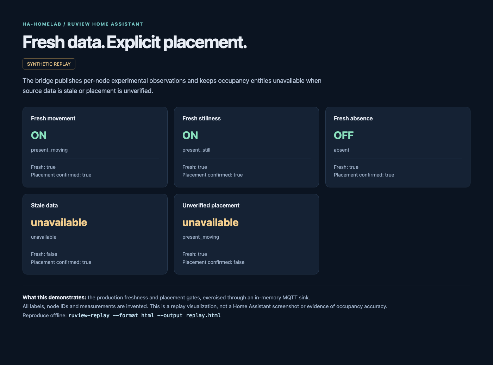

# RuView Home Assistant

**Experimental observations, not validated occupancy detection.**

A small Python bridge from an existing RuView collector to Home Assistant MQTT discovery. It publishes fresh per-node presence, motion, classification and RSSI observations, with optional edge flags and server-module diagnostics. It never infers room occupancy from aggregate counts or default coordinates.

Select a tag from [Releases](https://github.com/ha-homelab/ruview-home-assistant/releases): `-beta.N` identifies a beta, `-rc.N` a release candidate, and a tag without a prerelease suffix a stable software release. Verify the release's [signed asset inventory](docs/release-signatures.md) for that tag before installation. Stable software does not establish validated occupancy detection or sensing accuracy.



*This is an offline synthetic replay visualization, not a Home Assistant screenshot. All values and labels are invented. It demonstrates the bridge's gating logic, not sensing accuracy.*

## Try it without hardware

Python 3.11 or newer is required. From a downloaded release or checkout:

```sh
python3 -m venv .venv
. .venv/bin/activate
python3 -m pip install .
ruview-replay
ruview-replay --format html --output replay.html
```

Open `replay.html`. Five invented cases exercise the production observation and publication code: movement, stillness, absence, stale data and unverified placement. No collector, MQTT broker, credentials or network connection is used by replay. Installation requires access to the Python package index unless dependencies are already cached.

## Connect your own services

You need an existing compatible RuView collector, an MQTT broker and Home Assistant's MQTT integration. This project does not ship collector firmware, a CSI receiver, model weights or Home Assistant itself.

```sh
cp .env.example .env
# Edit .env with your own service URLs and MQTT settings.
docker compose up --build -d
```

For Python deployment, export the variables documented in [configuration](docs/configuration.md), then run `ruview-home-assistant` (or `python3 -m ruview_home_assistant`). The Python command does not automatically read `.env`; Compose does. Do not execute a `.env` file as shell code.

Presence and motion entities remain unavailable until you explicitly confirm each node's placement. Confirming placement means you checked the node-to-location mapping; it does not validate recognition accuracy or room coverage. Start with the diagnostic entities and observe behavior before considering convenience automations.

## What it is useful for

- Inspecting whether individual collector nodes are delivering fresh classifications and signal diagnostics.
- Learning the MQTT discovery and availability behavior using reproducible synthetic examples.
- Comparing experimental observations with independent ground truth during a controlled evaluation.
- Reusing the observation validation and bounded HTTP decoder in another Python application.

Unverified classifications and possible-fall flags are unsuitable for emergency response, health monitoring, security decisions or any action that requires reliable detection. The optional server-module adapter only exposes explicitly experimental diagnostic outputs; it does not supply presence, posture, counts or positions.

## Documentation

- [Configuration and placement](docs/configuration.md)
- [Deployment, upgrades, reconnects and cleanup](docs/operations.md)
- [Payload contract v1](docs/payload-contract-v1.md)
- [Python API and migration](docs/python-api.md)
- [Troubleshooting](docs/troubleshooting.md)
- [Scope and limitations](docs/beta.md)
- [Contributing](CONTRIBUTING.md), [security reporting](SECURITY.md), [changelog](CHANGELOG.md)

## Develop and package

```sh
python3 -m pip install '.[dev]'
./scripts/check.sh
python3 scripts/build_release.py
```

Checks are offline and synthetic. The release builder creates a source ZIP, installable source distribution, wheel and SHA-256 checksum file in `dist/`. Dependencies and build tools may be downloaded during packaging. No publishing occurs. See [dependency notices](THIRD_PARTY_NOTICES.md) for licenses; project-owned code is MIT licensed.
